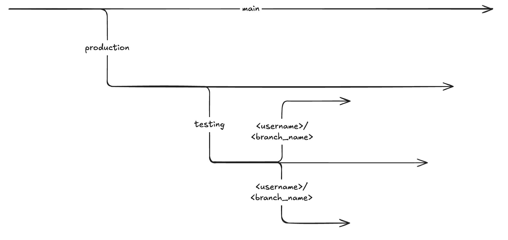

#### Branching System

Here’s a visual of our branching model—`main` always holds our snapshots, `production` is auto-deployed, `testing` is our staging ground for changes, and everyone works in their own feature branch off of `testing`:



Branching workflow: main → production → testing → `<username>/<branch>`

#### Development 

1.  Clone the repository

    ``` bash
    git clone <github.com/repo>
    cd <repo>
    ```

2.  Sync your local branches

    ``` bash
    git fetch --all
    git checkout main
    git pull origin main
    git checkout testing
    git pull origin testing
    ```

3.  Create a new branch for yourself

    ``` bash
    # Replace <username>/<branch_name> with your identifier
    git checkout -b <username>/<branch_name> testing
    ```

4.  Work on your notes and commit changes

    ``` bash
    git add .
    git commit -m "notes: Brief description of your changes"
    ```

5.  Push your branch to remote

    ``` bash
    git push -u origin <username>/<branch_name>
    ```

6.  Open a Pull Request to merge into testing

    ``` bash
    # Using GitHub CLI:
    gh pr create --base testing --head <username>/<branch_name> --title "Your PR title" --body "Description of changes"
    ```
    Or open a PR via the GitHub web UI, targeting the `testing` branch.

7.  Resolve merge conflicts

    -   If you encounter any merge conflicts when merging into `testing`, ping @admin for assistance before proceeding.

8.  Verify changes on testing

    -   The `testing` branch is not auto-deployed via GitHub Pages.
    -   Preview changes locally and then get an admin to sign-off.

9.  Promote changes to production

    ``` bash
    # Admin only
    git checkout production
    git pull origin production
    git merge testing
    git push origin production
    ```
    -   The `production` branch is auto-deployed via GitHub Pages at `https://<link>`.

10. Archive a snapshot on main

    ``` bash
    git checkout main
    git pull origin main
    git merge production
    git push origin main
    ```


